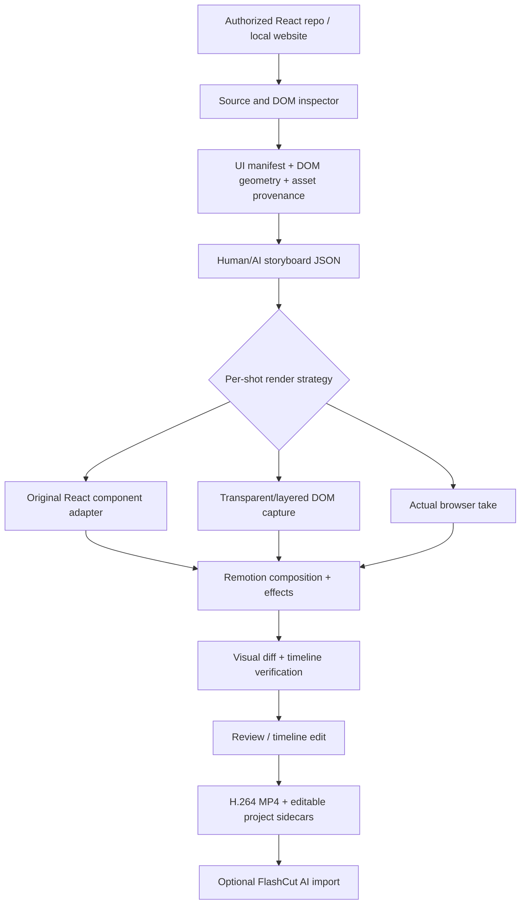

# UI Motion Engine

**A source-faithful React website → cinematic Remotion video workflow.**

> **Repository status:** architecture, complete implementation plan, machine-readable contracts, working local DOM-inspection utility, validator and animation reference. **Not yet an end-to-end video generator.** No fake website UI, no imaginary completion claims.

## The exact problem

Given an actual website or React repository, make a promotional video in which the **real UI appears intact** and **real components detach, float, zoom, rotate, highlight, change internal state, then return to their precise original positions**. Never have an AI invent similar-looking cards. Use browser footage only where actual interaction is required.

**First target:** private `Brave-developments/fivem-resource-hub` (React 18, Vite, `apps/web`, Fastify/PostgreSQL API). **Downstream editor:** private `Brave-developments/flashcut-ai` (Remotion 4.0.534 / React 19; existing demo recorder, timeline, export). The projects are **not copied** into this repository. Their source is inspected and consumed from a user-authorized local checkout.

## Three exact-fidelity techniques — in priority order

| Tier | How it works | What can be animated | Fidelity / limits |
| --- | --- | --- | --- |
| **A: Live original React component** | Load real component, CSS, fonts, assets and providers through a narrow video adapter. Render a second instance on top of the background; hide the original visually during extraction. | Entire card *and its children*: text, thumbnail, fire button, price, icons, conditional states | **Preferred.** Requires code access and dependency/runtime adaptation; may be incompatible with some apps. |
| **B: Layered DOM capture** | Playwright captures actual background, element bounds and separately rendered element/child layers; animate the extracted layers over a card-free background. | Whole card and separately captured sublayers; can add overlays | Pixel-faithful but individual layers are raster; element screenshot alone is **not guaranteed transparent**. Isolation/alpha or a video component renderer is needed. |
| **C: Real browser take** | Playwright drives actual search, scroll, clicks and records a browser take. Remotion adds transitions, zoom and overlays. | Camera, crop, overlays and compositing, **not** independent DOM internals | Reliable fallback for interactions; can't genuinely change card geometry after recording. |

A single finished reel can mix A, B and C. The **original website remains the visual source of truth** in every tier. An agent must **not silently switch to a recreated UI**.

## Proposed user experience

1. **Import:** paste a local source-repo path or authorized GitHub URL, optionally a running local URL. Select landscape 1920×1080 or vertical 1080×1920.
2. **Inspect:** detect framework, components, pages, CSS, fonts, image assets, routes and live DOM bounding boxes. Give each candidate a **confidence and renderability status**.
3. **Select:** click the actual on-screen card, hero title, search bar or button; optionally select the card's title/thumbnail/fire button as child targets.
4. **Direct:** type “Lift the Fire resource card from the grid; rotate 12°, glow, expand and return.” AI translates this to a **reviewable JSON storyboard**, never new JSX for visual likeness.
5. **Preview:** Remotion Studio/Player previews each shot. Red flags explicitly mark substituted image capture, missing fonts, broken assets or data.
6. **Render:** reproducible MP4, screenshot evidence, storyboard JSON, manifest and trace. Later, export/import those finished video clips into FlashCut AI.

## Example 30-second storyboard

| Time | Scene | Visual source |
| --- | --- | --- |
| 0–4 s | Website hero reveal with subtle dolly and cursor arrival | Original website page (A or B) |
| 4–10 s | Click or hover resources; one real card lifts in a 3D tilt, background dims | Original card component + measured DOM position (A) |
| 10–15 s | Thumbnail expands, real download CTA pulses, Fire effect blooms | Card child components (A); effect overlay |
| 15–19 s | Card flies back to its measured grid position | A; match end frame to background |
| 19–25 s | Real search/type/filter demonstration | Browser recording (C) |
| 25–30 s | Logo + CTA, no fabricated statistics | Original branding and motion typography |

## Architecture map



## What's in this repository

| Resource | Start here for |
| --- | --- |
| [`docs/01-PRODUCT-SPEC.md`](docs/01-PRODUCT-SPEC.md) | Exact product goals, boundaries and acceptance criteria |
| [`docs/02-ARCHITECTURE.md`](docs/02-ARCHITECTURE.md) | Pipeline, coordinates, job model, data flow |
| [`docs/03-COMPONENT-ADAPTERS.md`](docs/03-COMPONENT-ADAPTERS.md) | True source component reuse, dependencies and React 18/19 issue |
| [`docs/04-CAPTURE-AND-EXTRACTION.md`](docs/04-CAPTURE-AND-EXTRACTION.md) | Real browser capture, card isolation, background plate and transparent layers |
| [`docs/05-MOTION-DESIGN.md`](docs/05-MOTION-DESIGN.md) | Flying-card motion, child animation, compositing details |
| [`docs/06-AI-AGENT-CONTRACT.md`](docs/06-AI-AGENT-CONTRACT.md) | Agent responsibilities, allowed actions, structured prompts |
| [`docs/07-EDITOR-AND-WORKFLOW.md`](docs/07-EDITOR-AND-WORKFLOW.md) | UI flow, preview, render and manual override |
| [`docs/08-SECURITY-AND-RIGHTS.md`](docs/08-SECURITY-AND-RIGHTS.md) | Host sandboxing, credentials, licenses, provider/privacy handling |
| [`docs/09-QUALITY-AND-TESTS.md`](docs/09-QUALITY-AND-TESTS.md) | Snapshot parity, motion tests, end-to-end acceptance |
| [`docs/10-ROADMAP.md`](docs/10-ROADMAP.md) | Build phases, concrete tasks, stop/go gates |
| [`docs/11-FIVEM-HUB-PILOT.md`](docs/11-FIVEM-HUB-PILOT.md) | First app mapping and video plan |
| [`docs/12-FLASHCUT-BRIDGE.md`](docs/12-FLASHCUT-BRIDGE.md) | Integrate without copying/rebuilding FlashCut |
| [`docs/13-ENGINEERING-HANDOFF.md`](docs/13-ENGINEERING-HANDOFF.md) | Copy-paste implementation-agent brief |
| [`docs/14-REFERENCE-AND-DECISIONS.md`](docs/14-REFERENCE-AND-DECISIONS.md) | Decisions, official docs, open questions |
| [`docs/15-OPERATIONS.md`](docs/15-OPERATIONS.md) | Installation, inspection, artifact handling, troubleshooting |
| [`specs/`](specs/) | Machine-readable UI manifest, storyboard schemas and worked examples |
| [`scripts/inspect-dom.mjs`](scripts/inspect-dom.mjs) | **Usable** local DOM inspection and screenshot proof-of-concept |
| [`scripts/validate.mjs`](scripts/validate.mjs) | Validate example contracts using JSON Schema |
| [`src/geometry.mjs`](src/geometry.mjs) | Tested CSS-viewport to video-coordinate transformations |
| [`PUBLISH_TO_GITHUB.md`](PUBLISH_TO_GITHUB.md) | Create a separate private GitHub repo and push this package |
| [`examples/`](examples/) | A Remotion card extraction pattern and adapter interface examples |

## Quick inspection proof-of-concept (not yet video render)

Requirements: **Node.js 22.12+**, Chromium browser installed by Playwright.

```bash
npm install
npx playwright install chromium
# separately start your local website (e.g. fivem-resource-hub on localhost:5173)
npm run inspect -- --url http://127.0.0.1:5173 --selector '[data-motion-id="resource-card"]' --out out/inspect
npm test
```

The `inspect` script captures an authentic viewport screenshot plus metadata and one element screenshot when a matching selector is present. Without a known selector, it still captures the website, records DOM candidates and produces a machine-readable report. It **does not extract an editable React component or generate a movie**. Read [`docs/15-OPERATIONS.md`](docs/15-OPERATIONS.md).

## Roadmap / priority order

**Phase 0:** source audit and measurement. **Phase 1:** one real resource card extracted + animated back with exact layout. **Phase 2:** auto-discovery and safe adapters. **Phase 3:** hybrid browser takes and multiple scenes. **Phase 4:** preview, review and export. **Phase 5:** optional AI director. **Phase 6:** optional integration into FlashCut AI. See the full gated board in [`docs/10-ROADMAP.md`](docs/10-ROADMAP.md).

### Non-negotiable engineering rules

- **Real source only:** never write surrogate website JSX or approximate CSS when a source adapter can work; explicit user-approved fallback only.
- **Exact identifiers and data:** no invented FiveM download counts, resource thumbnails, product claims or user reactions.
- **No invasive edits:** adapter code lives in this project by default. Any hooks added to source apps need a separate opt-in PR.
- **Visible failures:** failed import, unsupported provider, missing image or mismatch are surfaced — not hidden behind a fake card.
- **Deterministic:** motion changes only with frame, inputs and pinned snapshots; no timers or random nondeterminism.
- **Read-only source:** avoid changing the production site, DB or reaction counts just to shoot a promotional video.

## Publishing and licensing

This is an **internal project plan/starter**, not a grant of rights to proprietary source or third-party assets. No license is assigned to this repository. Decide whether and how to open-source before publishing. The engine must preserve licence and attribution metadata for anything extracted from a website.